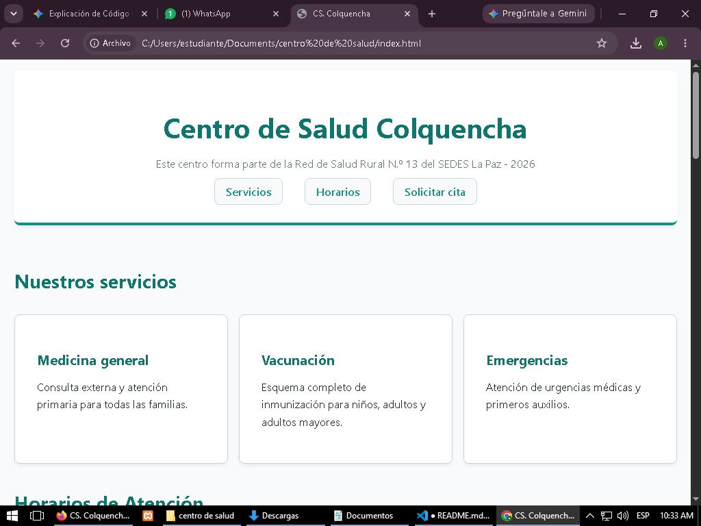

# Centro de Salud Colquencha
**Estudiante:** Anhay Choquehuanca Mamani
**Cliente:** Centro de Salud Colquencha
**URL publicada:**

## Qué resuelve 
Resuelve la accesibilidad a un sitio web para un centro de salud y también la adaptabilidad en diferentes dispositivos. El sitio ofrece información sobre los sevicios que ofrece este centro como: medicina general, vacunaciones para todo tipo de edad y también la atención de emergencias para urgencias médicas.
También se ve los horarios que se tienen sobre los distintos servicios.
Formularios citas medicas via online, jpara quienes no siempre estan cerca de este establecimiento o hacerlas directamente desde la misma página.
Podran encontrar los avisos importantes, como también el contacto de emergencia 

## Cómo esta construido 
**Semántica:** Se utilizó header y nav para el encabezado superior para el título principal y la barra de navegación del sitio. 
main 
Article usados como contenedores dentro de una sección (en este caso servicios) para estructurar cada servicio médico de forma independiente.
Table para crear la tabla de datos y caption para el subtítulo.
figure, img, figcaption: para la imagen y su respectivo pie de foto.
form dentro de este va fieldset, legend para los subtitulos, label para definir lo que debe llenar en los espacios e input para que los ingrese.
se uso option para que el usuario pueda elegir el tipo de servicio que requiere y button al final del formulario para que se envie la cita.
Un aside para otra sección de avisos importantes.
Un footer para la sección de contacto.
**Layout:** display: flex para la barra de navegacion en una sola línea y flex-wrap en pantallas pequeñas.
display: grid se aplicó en la sección de servicios para permitir crear una estructura bidimensional.
**Diseño:** Elegi esta paleta de colores porque transmite calma profesionalismo y un poco de naranja para llamar la atencion en donde se aplico y el fondo claro para garantizar una alta legilibilidad.
tipografia system-ui porque es legible y ofrece una experiencia visula familiar

## Capturas

## lo más difícil
lo más difícil fue poder acomodar como queria que viera la página, tambien el entender lo que cada línea de código hace.
